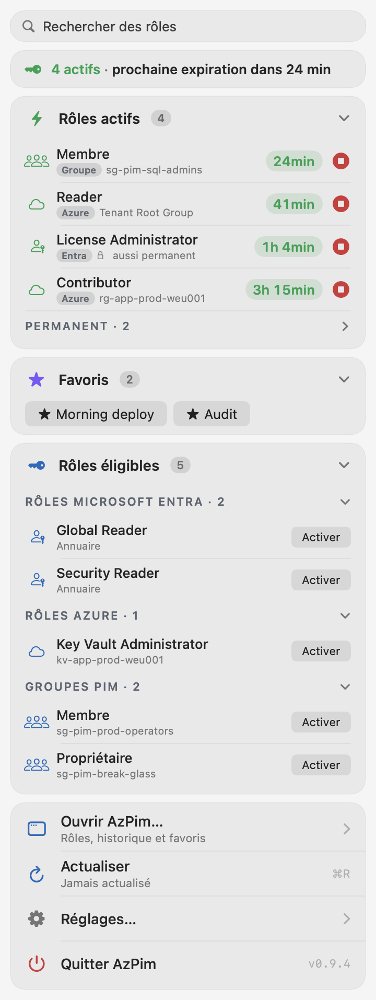
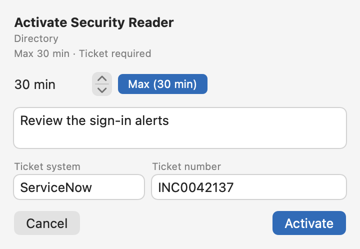
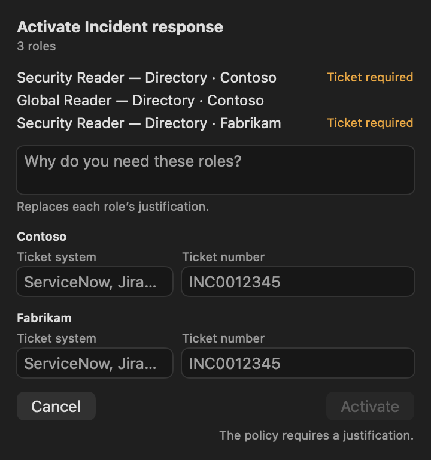
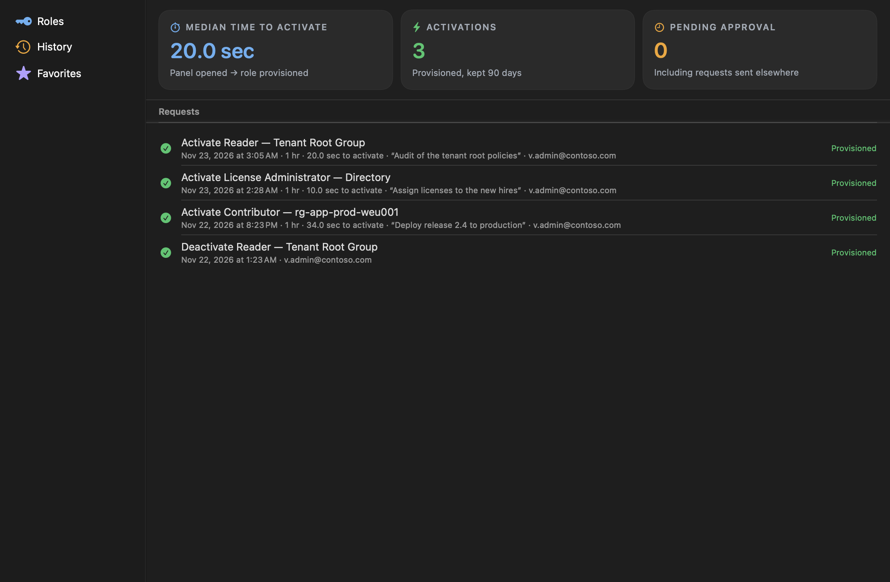
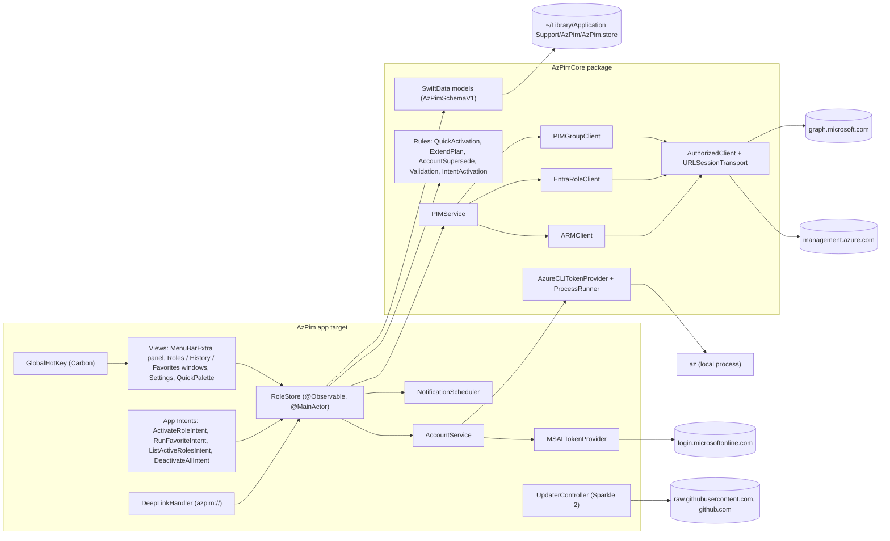
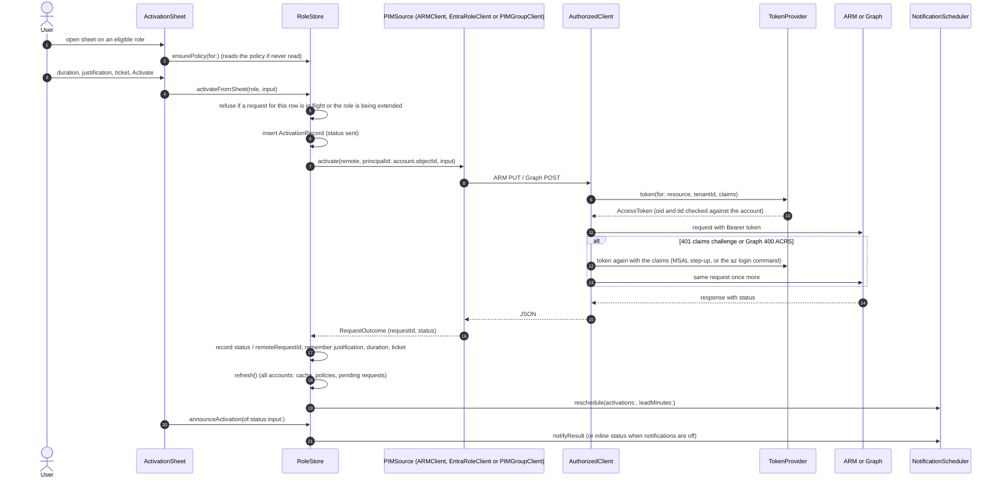

<p align="center">
  
</p>

<h1 align="center">AzPim</h1>

<p align="center">
  Your Microsoft PIM roles in the macOS menu bar: see what is active, activate, extend and end roles,
  without opening the Azure portal.
</p>

<p align="center">
  <a href="https://vincentlauriat.github.io/AzPim/">Website</a> ·
  <a href="#install">Install</a> ·
  <a href="#sign-in">Sign-in</a> ·
  <a href="#privacy-and-security">Privacy</a> ·
  <a href="#technical-description">Technical description</a> ·
  <a href="LICENSE">MIT license</a>
</p>

<p align="center">
  
  
</p>

> **Status: 1.0.** Sign in with Microsoft (client ID built in, no app registration of your own) or with the Azure
> CLI. Verified live: Entra roles, PIM groups, MFA step-up. Not verified live yet: Shortcuts run headless
> (`shortcuts run`, Raycast), see the Shortcuts row below.

## Contents

**Presentation**
[Why](#why) · [Features](#features) · [Install](#install) · [Sign-in](#sign-in) ·
[Privacy and security](#privacy-and-security)

**Technical description**

1. [Architecture](#1-architecture)
2. [An activation, end to end](#2-an-activation-end-to-end)
3. [Identity and tokens](#3-identity-and-tokens)
4. [Microsoft APIs](#4-microsoft-apis)
5. [Extend](#5-extend)
6. [Persistence](#6-persistence)
7. [Refresh, expiry notifications and the menu bar countdown](#7-refresh-expiry-notifications-and-the-menu-bar-countdown)
8. [Quick-activate palette and global shortcut](#8-quick-activate-palette-and-global-shortcut)
9. [Shortcuts (App Intents) and `azpim://` links](#9-shortcuts-app-intents-and-azpim-links)
10. [Localization and accessibility](#10-localization-and-accessibility)
11. [Security model](#11-security-model)
12. [Build, tests and CI](#12-build-tests-and-ci)

**Maintenance**
[Releasing](#releasing) · [Rollback and withdrawal](#rollback-and-withdrawal) · [Project layout](#project-layout) ·
[Roadmap](#roadmap) · [License](#license)

## Why

Privileged Identity Management (PIM) gives you roles *just in time*: you activate a role for a few hours, with a
justification, then it expires. In the portal that is 6 to 10 clicks per role, and nothing tells you that a role is
about to end in the middle of a deployment. AzPim keeps all of it one click away in the menu bar.

## Features

| | |
|---|---|
| **Active roles at a glance** | The panel opens on the number of active PIM roles, the next expiry and a progress bar; permanent roles are listed too. |
| **Menu bar countdown** | `2 · 0:41` next to the key icon, orange at 15 minutes, red at 5. |
| **One-click activation** | Duration capped by the role policy, last justification pre-filled. From the Activation Sheet, the result arrives as a notification (or inline when notifications are off), not a dialog. |
| **Least-privilege durations** | The sheet starts on the duration you last used for the role (1 h the first time), in 15-minute steps up to the policy maximum, with a **Max** button. |
| **Ticket fields** | Ticket system and number side by side when the policy asks for them, remembered per tenant; a favorite asks once per tenant. |
| **Quick-activate palette** | ⌃⌥P from any app: type a few letters, Return activates with the default duration, ⌘Return opens the sheet. |
| **Deactivate** | End a role as soon as you are done (Azure refuses it in the first 5 minutes; the button says so). |
| **Expiry notifications** | A reminder before the end, with an **Extend** button. |
| **Favorites** | Activate several roles in one click, from the panel or `azpim://activate?favorite=<name>` (always confirmed). |
| **Shortcuts** | *Activate Role*, *Run Favorite*, *List Active Roles* and *Deactivate All Roles* actions for Shortcuts, Siri and Spotlight (and Raycast or Alfred through `shortcuts run`). Every request is confirmed, missing justifications and tickets are asked, and the same setting as links turns activation off (*Deactivate All Roles* is not gated by it: it only removes access, after its own confirmation). A shortcut started by `shortcuts run` or Raycast still shows the confirmation; with no UI to show it, it fails without sending anything (to be verified live). |
| **History** | Every request, pending approvals (including ones sent from the portal) with **Cancel**, CSV export, median time to activate. |
| **Roles window** | Search and filter every role, see its policy: maximum duration, justification, ticket, MFA, approval. |
| **Several accounts and tenants** | One panel, filter per account; a favorite spanning tenants shows each role's tenant. |
| **Three PIM sources** | Azure resource roles, Entra roles and PIM for Groups. *Sign in with Microsoft* (recommended at onboarding) brings all three; the Azure CLI covers Azure roles only. |
| **French and English** | The app follows the macOS language. |

<p align="center">
  
</p>
<p align="center">
  
  
</p>
<p align="center">
  
</p>
<p align="center">
  
</p>

Screenshots use demo data (Contoso).

## Install

Requires macOS 14 or later. Download the signed and notarized DMG from
[GitHub Releases](https://github.com/vincentlauriat/AzPim/releases/latest) and drag AzPim to Applications.
Updates arrive automatically through Sparkle, or from Settings › About › Check for Updates.

> **Upgrading from 0.9.x (AzurePim).** Up to 0.9.3 the app was called AzurePim. AzPim has a new bundle id, so
> AzurePim does not update to it: its update check points to this page instead. Quit AzurePim, download AzPim once
> by hand and open it (it asks you to quit AzurePim if it is still running). On first launch it copies its local
> data (the account list, favorites and history) from `~/Library/Application Support/AzurePim/` and its panel and
> link preferences, leaving the originals in place, and registers itself at login if AzurePim was. Then remove
> AzurePim from Applications and its entry from System Settings › General › Login Items; AzPim reminds you once if
> AzurePim is still installed. Microsoft sign-in accounts may ask you to sign in again. Updates then arrive
> automatically again.

To build from source, you need Xcode (stable) and [XcodeGen](https://github.com/yonaskolb/XcodeGen):

```bash
git clone https://github.com/vincentlauriat/AzPim.git && cd AzPim
xcodegen generate
xcodebuild -project AzPim.xcodeproj -scheme AzPim -configuration Debug \
  -derivedDataPath build build
open build/Build/Products/Debug/AzPim.app
```

AzPim lives in the menu bar, with no Dock icon. On a notched MacBook with a full menu bar, the key icon may be
hidden: free some room or use a menu bar manager.

## Sign-in

| Mode | What you need | What you get |
|---|---|---|
| **Azure CLI** | `brew install azure-cli`, then `az login` | Azure resource roles. Nothing to register, no admin needed. |
| **Microsoft sign-in** | In most tenants, a one-time admin consent (the client ID is built in; a custom one can be set in Settings › Accounts) | Azure resource roles, Entra roles and PIM groups. |

The Azure CLI token cannot request the Graph PIM permissions, which is why Entra roles and PIM groups need the
Microsoft sign-in. Delegated permissions, always on behalf of the signed-in user:

- `https://management.azure.com/user_impersonation`
- `User.Read`
- `RoleEligibilitySchedule.Read.Directory`, `RoleAssignmentSchedule.ReadWrite.Directory`, `RoleManagementPolicy.Read.Directory`
- `PrivilegedEligibilitySchedule.Read.AzureADGroup`, `PrivilegedAssignmentSchedule.ReadWrite.AzureADGroup`, `RoleManagementPolicy.Read.AzureADGroup`

A ready-to-send email for your tenant admin is in
[docs/admin-consent/email-template-tenant-admin.md](docs/admin-consent/email-template-tenant-admin.md).

AzPim never grants anything by itself: every activation goes through PIM, which still enforces approval, MFA,
ticket and maximum duration.

## Privacy and security

- **No server, no telemetry, no account.** For your roles, AzPim talks only to `management.azure.com`,
  `graph.microsoft.com` and `login.microsoftonline.com`. Release builds also check for updates on
  `raw.githubusercontent.com` (the Sparkle feed) and download updates from GitHub Releases.
- **AzPim stores no token.** The Azure CLI keeps its own; the Microsoft sign-in uses the Keychain cache of
  Microsoft's MSAL library.
- **Local data** (roles, policies, history, favorites) sits in `~/Library/Application Support/AzPim/`, a folder
  only your user can read. *Settings › Accounts › Privacy › Delete All Local Data* removes Microsoft sign-ins from
  MSAL's Keychain cache, forgets Azure CLI accounts (your `az` session is not touched) and deletes every account,
  role, favorite and history row from the local store (details in [Persistence](#6-persistence)).
- **Small preferences** (remembered durations, ticket system per tenant, recent ticket numbers kept 8 h) are in the
  app's preferences file, `~/Library/Preferences/fr.vincentlauriat.azpim.plist`.
- **`az` is run safely:** explicit arguments, no shell, a minimal environment; a custom path must be owned by you or
  root and not writable by others.
- Two independent security reviews ran during development; findings and accepted risks are in the
  [TRD](TRD.md#security-and-privacy). The [security model](#11-security-model) below sums up what the code does.

---

# Technical description

Everything below is read from the code of this repository (1.0, build 7). Paths are relative to the repository root.
Type and function names are the ones in the sources. Where the design documents ([TRD.md](TRD.md),
[BackendSchema.md](BackendSchema.md)) say otherwise, the code wins, and this section follows the code.

## 1. Architecture

AzPim is a SwiftUI app (Swift 6 language mode, `SWIFT_STRICT_CONCURRENCY: complete`, macOS 14+, universal binary)
split in two:

- **`Packages/AzPimCore`**, a Swift package with no third-party dependency and no UI. It holds the SwiftData
  models, the ARM and Graph clients, the Azure CLI token provider, and the pure rules (validation, durations,
  tickets, supersession, quick activation, Extend planning). Most of it is tested by `swift test` alone.
- **The `AzPim` app target** (`AzPim/`), which depends on `AzPimCore`, MSAL (pinned to 2.17.1) and Sparkle
  (pinned to 2.10.1). It holds the stores, the MSAL token provider, notifications, the global shortcut, deep links,
  App Intents and every view.



| Component | File | Role |
|---|---|---|
| `AzPimApp` | `AzPim/AzPimApp.swift` | Entry point. Opens the store (after the one-time AzurePim migration), builds `AccountService`, `NotificationScheduler`, `RoleStore` and `QuickPaletteController`, wires notification actions and the hot key, then calls `RoleStore.start()`. Scenes: `MenuBarExtra` (`.window` style), the main `Window`, onboarding, the admin-consent `WindowGroup` and `Settings`. |
| `RoleStore` | `AzPim/Services/RoleStore*.swift` | The single source of state for every view: refresh loop, countdown clock, cache sync, activate / deactivate / extend, favorites, pending requests, history retention, durations and tickets memory. |
| `AccountService` | `AzPim/Services/AccountService.swift` | Adds, removes and signs in accounts; hands out the `TokenProvider` of each account; *Delete All Local Data*. |
| `PIMService` | `Packages/AzPimCore/Sources/AzPimCore/PIM/PIMService.swift` | Builds the sources of an account (`PIMService.sources(token:directory:)`) and refreshes them concurrently into an `AccountSnapshot`. |
| `PIMSource` | `…/PIM/PIMTypes.swift` | The protocol of one source: `eligibilities`, `assignments`, `policy(for:)`, `activate`, `deactivate`, `pendingRequests`, `status(ofRequest:)`, `cancel(request:)`. |
| `ARMClient`, `EntraRoleClient`, `PIMGroupClient` | `…/PIM/ARMClient.swift`, `…/PIM/GraphClient.swift`, `…/PIM/PIMRequests.swift` | The three PIM sources, normalized to `RemoteEligibility` / `RemoteAssignment` / `RolePolicy` / `RequestOutcome`. |
| `AuthorizedClient` | `…/PIM/HTTPClient.swift` | Bearer-token JSON client: retries, claims challenges, paging, error mapping. |
| `TokenProvider` | `…/Auth/TokenProvider.swift` | `token(for:tenantId:claims:)` and `identity(tenantId:)`; implemented by `AzureCLITokenProvider` (core) and `MSALTokenProvider` (app). |
| `NotificationScheduler` | `AzPim/Services/NotificationScheduler.swift` | Expiry reminders with Extend / Dismiss, result notifications, approval decisions. |

The views never talk to Microsoft. They read SwiftData through `@Query` and call `RoleStore` methods, which
return a status or a message. Network work runs on Swift concurrency (`async`/`await`, `TaskGroup`, `async let`).
The state that views observe lives on the main actor. `AzureCLITokenProvider` is an `actor`.

## 2. An activation, end to end

From the Activation Sheet (`AzPim/Views/ActivationSheet.swift`). The palette and the panel's Return go through
`RoleStore.quickActivate`, which reaches the same `RoleStore.activate`.



What `RoleStore.activate` guarantees (`AzPim/Services/RoleStore.swift`):

- **One request per row.** `inFlight` holds the ids of rows with a request in flight. A second tap, a second sheet,
  or a favorite during an Extend is refused with `ActivationBlock.inProgress`.
- **Every attempt is recorded.** An `ActivationRecord` is inserted before the request. A `Failed`, `Denied` or
  `Canceled` answer is turned into the `RequestRefused` error: nothing was applied, the row shows the error, and
  the record keeps the status.
- **Nothing is sent twice.** This check is made by the callers, not by `activate` itself: the sheet
  (`ActivationBlock`), `quickActivate`, `runFavorite` and `IntentActivation` refuse a role with a waiting request
  (`RoleStore.waitingRequest`, `ActivationRecord.isWaiting`). A pending approval waits until a decision; a request
  still `sent` waits 15 minutes.
- **The token belongs to the account.** `RoleStore.sources(for:)` (`RoleStore+Accounts.swift`) wraps the token
  source. A token whose `oid` and `tid` claims do not match the account is refused before any request. This covers
  `az login` switched to someone else meanwhile, or MSAL returning another identity.

## 3. Identity and tokens

Each `Account` has a `mode` (`SignInMode.azureCLI` or `.msal`). `AccountService.provider(for:)` returns its
`TokenProvider`. `PIMService.sources(token:directory:)` builds `ARMClient` always, and `EntraRoleClient` and
`PIMGroupClient` only when `account.directoryAccess == .enabled`.

### Azure CLI (`Packages/AzPimCore/Sources/AzPimCore/Auth/AzureCLITokenProvider.swift`)

- **Command.** `az account get-access-token --resource <https://management.azure.com/> --output json [--tenant <tid>]`,
  run by `ProcessRunner` with an explicit argument array (no shell), stdin closed, both pipes drained.
- **Timeout.** 20 s, after which the process gets SIGTERM, then SIGKILL one second later.
- **Locating `az`.** The path set in Settings comes first, then `/opt/homebrew/bin/az`, `/usr/local/bin/az` and
  `/usr/bin/az`. Every candidate must pass `Validation.trustedAZ`: it must be an executable named `az`, and the link,
  its resolved target and every ancestor folder must be owned by root or the user, not world-writable, and
  group-writable only for wheel or admin (Homebrew's prefix is admin-writable). It is checked on every use, and the
  resolved path is what runs.
- **Environment.** An allowlist only: `HOME`, `USER`, `LANG=en_US.UTF-8`, and a fixed `PATH` (the folder of `az`
  first). `AZURE_CORE_ONLY_SHOW_ERRORS=true` and `AZURE_CORE_COLLECT_TELEMETRY=false` are set. `AZURE_CONFIG_DIR` is
  passed through only if that folder passes the same ownership check.
- **Cache.** Tokens are kept in memory per resource and tenant until 5 minutes before they expire
  (`AccessToken.isValid`). Concurrent sources share one `az` process. A refresh started by the user (⌘R, Sign in)
  clears the cache, so a new `az login` counts at once. `identity(tenantId:)` never uses the cache.
- **Scope.** Graph PIM scopes cannot be obtained with the CLI's token (AADSTS65002): CLI accounts read Azure
  resource roles only (`DirectoryAccess.notApplicable`).
- **Step-up.** A claims challenge cannot be answered silently. `token(for:tenantId:claims:)` throws
  `TokenError.cliStepUp`, which carries the command to copy:
  `az login --tenant <tid> --scope https://management.core.windows.net//.default --claims-challenge <base64>`.
- **Errors.** stderr is mapped by `mapError`. AADSTS50076, 50079, 700082, 70043, "refresh token" and similar texts
  become `cliNotSignedIn(command:)`, which the banner shows as `az login --tenant …`.

### Microsoft sign-in, MSAL (`AzPim/Services/MSALTokenProvider.swift`)

- **Public client.** A multi-tenant public client: no secret, authority
  `https://login.microsoftonline.com/organizations`, redirect URI `msauth.<bundle id>://auth` (registered as a URL
  scheme in `project.yml`).
- **Client ID.** Read from `AzPimClientID` in Info.plist, which `project.yml` fills from the build setting
  `AZPIM_CLIENT_ID` in `Config/AzPim.xcconfig`. A git-ignored `Config/AzPim.local.xcconfig` can override it.
  At runtime, *Settings › Accounts › Custom client ID* (`AppSettings.customClientId`) comes first. Each account
  keeps the client ID it signed in with (`Account.msalClientId`), so removing it purges the right cache. With no
  valid ID, Microsoft sign-in is off (`TokenError.notConfigured`).
- **Token cache.** MSAL's Keychain cache with `keychainSharingGroup = "com.microsoft.identity.universalstorage"`.
  The entitlements (`AzPim/AzPim.entitlements`) declare `keychain-access-groups` =
  `KFLACS69T9.com.microsoft.identity.universalstorage`, plus `com.apple.application-identifier` and
  `com.apple.developer.team-identifier`.
- **Why the provisioning profile.** These entitlements are restricted: a Developer ID build must embed a
  provisioning profile that allows them, or macOS refuses to launch the app (the entitlements file names
  error 163). `Scripts/release.sh` embeds `embedded.provisionprofile` and checks it before signing: application
  identifier, `KFLACS69T9.*` keychain groups, expiry date, and that it contains the signing certificate. Debug
  builds are unsigned (`CODE_SIGNING_ALLOWED: NO`).
- **First sign-in.** `signIn()` is interactive with `prompt: .selectAccount`. It asks for the ARM
  `user_impersonation` scope, with `User.Read` as an extra scope to consent. `AccountService.addMSALAccount()` then
  calls `enableDirectoryAccess(for:)`.
- **Directory scopes.** The six scopes of `GraphScopes.directory` are tried silently first, against the account's
  tenant authority. If that fails, an interactive consent follows. If the tenant needs admin consent (AADSTS65001,
  90094 or 90095), the account becomes `.consentRequired`. The admin-consent sheet (`AdminConsentSheet.swift`)
  then builds `https://login.microsoftonline.com/<tenant>/v2.0/adminconsent?client_id=…&scope=https://graph.microsoft.com/.default`
  and a ready `mailto:` draft. Accounts left `.notRequested` get one silent try per launch
  (`trySilentDirectoryAccess`).
- **Silent first, one window at a time.** `acquire` tries `acquireTokenSilent`. Concurrent sources that need the
  user wait for the single open sign-in (`openSignIn`) instead of opening their own.
- **No window in the background.** Inside `TokenInteraction.$isBackground` (the timer refresh, the panel's stale
  refresh, the refresh after an expiry, the readiness wait of Shortcuts, and the policy reads a link or a favorite
  intent does before its confirmation), MSAL throws `TokenError.interactionRequired` instead of opening a window,
  and the panel shows a Sign in banner. Requests the user confirmed, including from Shortcuts, may open one (for a
  step-up).
- **Sign-out.** It removes the account from the MSAL cache. If that fails, the account is kept, so no orphaned
  credentials stay in the Keychain.

### Account supersession: CLI accounts superseded by MSAL

The same person can be added twice, once through `az` and once through Microsoft sign-in.
`AccountSupersede.supersession` (`Packages/AzPimCore/Sources/AzPimCore/Models/RoleDedup.swift`) decides which rows
count:

- **Same identity.** Two accounts are the same person when they share the tenant, and the object id (or, failing
  that, the UPN), ignoring case.
- **Source by source.** An MSAL account supersedes a CLI account of the same identity **source by source**, and only
  once it has loaded that source without error at least once (`RoleStore.loadedSources`). While MSAL keeps failing,
  the CLI rows stay.
- **Retired accounts.** A CLI account whose every source is superseded is *retired*. It is not refreshed, its
  cached assignments are deleted (they would count, notify and show twice), and its errors are forgotten. Its
  eligible roles stay hidden, so favorites still resolve. Its undecided requests move to the MSAL account and keep
  being polled.
- **Stable ids.** `Supersession.resolve(eligibleRoleId:source:)` rewrites a local id `<CLI account id>|<remote id>`
  to `<MSAL account id>|<remote id>`. The remote schedule id belongs to the identity, not to the sign-in, so
  favorites, notifications, links and Shortcuts made on the CLI account keep working.
- **Undo.** Removing the MSAL account brings the CLI account back at the next refresh.

### Step-up MFA (claims challenges and ACRS)

`AuthorizedClient.json` (`…/PIM/HTTPClient.swift`) retries a request **once** with claims in two cases:

- **401 with a `claims="…"` value in `WWW-Authenticate`.** ARM sends the claims base64-encoded and they are
  decoded; Graph may send JSON as is.
- **Graph 400 whose error message contains `claims=<url-encoded JSON>`** (`RoleAssignmentRequestAcrsValidationFailed`),
  where the decoded JSON names an `access_token` challenge.
  This happens with an Entra role whose policy requires an authentication context. The message may be nested as a
  JSON string inside `error.message`. The request was rejected, so stepping up and sending it again is safe.

The claims go to the token source. MSAL turns them into an `MSALClaimsRequest` and signs in interactively; the
Azure CLI throws `cliStepUp` with the `az login … --claims-challenge` command.

## 4. Microsoft APIs

All calls go through `AuthorizedClient` with `Accept: application/json`, `User-Agent: AzPim/<version>` and an
ephemeral `URLSession` with a 20 s request timeout (`URLSessionTransport`). Each source normalizes its answers into
`RemoteEligibility`, `RemoteAssignment` and `RolePolicy`.

### Azure resource roles: ARM `Microsoft.Authorization`, api-version `2020-10-01` (`ARMClient`)

Base URL `https://management.azure.com`; every call adds `?api-version=2020-10-01`.

| Purpose | Request |
|---|---|
| Eligible roles | `GET /providers/Microsoft.Authorization/roleEligibilityScheduleInstances?$filter=asTarget()` |
| Active assignments (activated and permanent) | `GET /providers/Microsoft.Authorization/roleAssignmentScheduleInstances?$filter=asTarget()` |
| Policy of a role | `GET {scope}/providers/Microsoft.Authorization/roleManagementPolicyAssignments?$filter=roleDefinitionId eq '<id>'`, read from `properties.effectiveRules` |
| Activate | `PUT {scope}/providers/Microsoft.Authorization/roleAssignmentScheduleRequests/{new UUID}` with `requestType: "SelfActivate"`, `principalId`, `roleDefinitionId`, `linkedRoleEligibilityScheduleId`, `justification`, `scheduleInfo.expiration {type: "AfterDuration", duration}`, optional `ticketInfo` |
| Deactivate | Same `PUT` with `requestType: "SelfDeactivate"` |
| Pending approvals | `GET /providers/Microsoft.Authorization/roleAssignmentScheduleRequests?$filter=asTarget()`, kept when the status maps to `pendingApproval` |
| Request status | `GET {request resource id}` |
| Cancel | `POST {request resource id}/cancel` |

Pending approvals use `asTarget()` rather than `asRequestor()` because, per the code comment, ARM refuses
`asRequestor()` at the root scope. The request id is kept as the full resource id, since status and cancel need the
scope.

### Entra roles: Graph v1.0 `roleManagement/directory` (`EntraRoleClient`)

Base URL `https://graph.microsoft.com/v1.0`.

| Purpose | Request |
|---|---|
| Eligible roles | `GET /roleManagement/directory/roleEligibilityScheduleInstances/filterByCurrentUser(on='principal')?$expand=roleDefinition` |
| Active assignments | `GET /roleManagement/directory/roleAssignmentScheduleInstances/filterByCurrentUser(on='principal')?$expand=roleDefinition` |
| Policy | `GET /policies/roleManagementPolicyAssignments?$expand=policy($expand=rules)&$filter=scopeId eq '/' and scopeType eq 'DirectoryRole' and roleDefinitionId eq '<id>'` |
| Activate | `POST /roleManagement/directory/roleAssignmentScheduleRequests` with `action: "selfActivate"`, `principalId`, `roleDefinitionId`, `directoryScopeId`, `justification`, `scheduleInfo {startDateTime: now, expiration {type: "afterDuration", duration}}`, optional `ticketInfo` |
| Deactivate | Same `POST` with `action: "selfDeactivate"` |
| Pending approvals | `GET /roleManagement/directory/roleAssignmentScheduleRequests/filterByCurrentUser(on='principal')?$expand=roleDefinition&$filter=status eq 'PendingApproval'` |
| Status / cancel | `GET …/roleAssignmentScheduleRequests/{id}`, `POST …/roleAssignmentScheduleRequests/{id}/cancel` |

### PIM for Groups: Graph v1.0 `identityGovernance/privilegedAccess/group` (`PIMGroupClient`)

| Purpose | Request |
|---|---|
| Eligible memberships / ownerships | `GET /identityGovernance/privilegedAccess/group/eligibilityScheduleInstances/filterByCurrentUser(on='principal')?$expand=group` |
| Active | `GET /identityGovernance/privilegedAccess/group/assignmentScheduleInstances/filterByCurrentUser(on='principal')?$expand=group` |
| Policy | `GET /policies/roleManagementPolicyAssignments?$expand=policy($expand=rules)&$filter=scopeId eq '<group id>' and scopeType eq 'Group' and roleDefinitionId eq '<member or owner>'` |
| Activate / deactivate | `POST /identityGovernance/privilegedAccess/group/assignmentScheduleRequests` with `action: "selfActivate"` / `"selfDeactivate"`, `principalId`, `groupId`, `accessId` (`member` or `owner`), plus justification, schedule and ticket for activation |
| Pending, status, cancel | `…/assignmentScheduleRequests/filterByCurrentUser(on='principal')?$expand=group&$filter=status eq 'PendingApproval'`, `…/{id}`, `…/{id}/cancel` |

For a group, `roleDefinitionId` holds `accessId` and `scope` holds the group id. `ticketInfo` has the same shape on
the three sources, `{ticketNumber, ticketSystem?}` (`ActivationInput.ticketInfo`, `Activity/Tickets.swift`). An
empty ticket system is left out rather than invented. Values from responses or from the store that go into OData
filters or path segments are escaped (`OData.literal`, `OData.segment`).

### Policies

`RolePolicy.read(rules:)` reads the end-user rules shared by ARM `effectiveRules` and Graph `policy.rules`. An answer
with none of these rule ids throws: an unknown policy is never treated as a policy without restrictions.

| Rule id | Field |
|---|---|
| `Expiration_EndUser_Assignment` | `maximumDuration` → `maxDuration` (ISO 8601) |
| `Enablement_EndUser_Assignment` | `enabledRules` containing `Justification`, `Ticketing`, `MultiFactorAuthentication` → `requiresJustification`, `requiresTicket`, `requiresMFA` |
| `Approval_EndUser_Assignment` | `setting.isApprovalRequired` → `requiresApproval` |
| `AuthenticationContext_EndUser_Assignment` | `isEnabled` → `requiresMFA` |

Policies are cached on `EligibleRole` for 24 h (`policyFetchedAt`). A failed read is retried after an hour, not on
every refresh. The Activation Sheet, quick activation, links and Shortcuts read a never-read policy first
(`ensurePolicy`). Extend always reads it fresh (`refreshPolicy`).

### Statuses

`RequestOutcome.status(from:)` maps ARM and Graph strings to `RequestStatus`:

| Microsoft status | `RequestStatus` |
|---|---|
| `Provisioned`, `Granted`, `Scheduled`, `ProvisioningStarted`, `PendingProvisioning`, `Accepted`, `AdminApproved`, `ScheduleCreated` | `.provisioned` |
| `PendingApproval`, `PendingApprovalProvisioning`, `PendingAdminDecision`, `PendingEvaluation` | `.pendingApproval` |
| `Denied`, `AdminDenied` | `.denied` |
| `Canceled`, `Revoked` | `.canceled` |
| `Failed`, `FailedAsResourceIsLocked`, `Invalid`, `TimedOut` | `.failed` |
| anything else | `.sent` |

### Pagination, throttling and retries

- **Paging.** `AuthorizedClient.list` follows `nextLink` (ARM) or `@odata.nextLink` (Graph) and concatenates the
  `value` arrays.
- **Same host only.** A next link to another host or to a non-https URL is refused, so the bearer token never leaves
  the host it was issued for. Redirects follow the same rule (`SameHostRedirects`).
- **Retries.** A 429 is retried for every method. A 5xx is retried for `GET` only: a write that failed with a 5xx may
  still have been applied, and is never sent twice. There are up to 3 retries, at 1 s, 2 s and 4 s, or after
  `Retry-After`, capped at 30 s.
- **Per source.** `PIMService.refresh()` runs the sources of an account concurrently. Inside each source, eligible
  roles and assignments load in parallel. A failing source never hides the others: its error goes to
  `AccountSnapshot.errors`, and its cached rows are kept.

### Error mapping

| Condition | Error | Shown as (`ErrorKind`) |
|---|---|---|
| HTTP 429 | `PIMError.throttled(retryAfter:)` | `.throttled`: "Microsoft is throttling requests — try again in …" |
| a nested Graph `errorCode: PermissionScopeNotGranted` (any status), or a 403 containing `PermissionScopeNotGranted` or `AADSTS65001` | `TokenError.consentRequired` | the account becomes `.consentRequired`; the admin-consent helper |
| other 403 | `PIMError.http(403, …)` | `.forbidden(message)`, Microsoft's text |
| other HTTP errors | `PIMError.http(status, code, message)` (Graph's JSON-in-`message` unwrapped) | `.other(message)` |
| `URLError.timedOut` | | `.timedOut` (one account, not "Offline") |
| no network (`notConnectedToInternet`, `cannotFindHost`, …) | | `.offline`: cached data stays, actions are disabled |
| CLI missing, signed out, step-up | `TokenError.cliNotFound`, `.cliNotSignedIn`, `.cliStepUp` | banner with the `az` command to copy |
| MSAL needs the user | `TokenError.interactionRequired` | banner with Sign in |

`ExtendPlan.isAlreadyActive` recognizes a 400 or 409 mentioning `RoleAssignmentExists`, "already exists" or
"already active".

## 5. Extend

PIM's `SelfExtend` applies to expiring *assignments* (with an admin approval), not to activations. AzPim never
sends it. TRD.md lists it, but the code does not. Extend (`RoleStore+Requests.swift`, `ExtendPlan` in
`Activity/Activity.swift`) **ends the current activation and activates the role again** with the parameters of the
request that made it:

1. **Find what to reuse.** The record that made the current activation is the latest provisioned activate or extend
   since `startAt` (5 min of clock skew allowed). If only an unconfirmed request exists, Extend stops: nothing is
   safe to reuse.
2. **Read the policy fresh.** If it cannot be read, Extend stops and the role stays active.
3. **Decide with `ExtendPlan.decide`.** Extend is blocked for approval, ticket or MFA policies, within 5 minutes of
   activation (Azure refuses changes then), and when a justification is required but none is known.
4. **Pick the duration.** The last duration of that request, else the one remembered for the role, else 1 h,
   capped by the policy.
5. **Deactivate, then activate again.** If the deactivation fails, the role is still active and the user is told.
   Azure may keep reporting the old activation for a few seconds, so the activation is retried after 0, 3, 6 and
   12 s. "Already active" refusals are discarded from History, except the last one. If every attempt fails, **the
   role is left deactivated**, and the message says so ("Role deactivated; re-activation failed…") so the user can
   activate it from the panel.

While this runs, the role is in `extending`, and its row and any replacement row show busy. Extend is reachable
from the panel row, from the palette (⇧Return) and from the expiry notification.

## 6. Persistence

### SwiftData

The container is built by `AzPimStore.makeContainer` (`Packages/AzPimCore/Sources/AzPimCore/Models/Schema.swift`).
Its schema is `AzPimSchemaV1` with `AzPimMigrationPlan`, which has no stages yet. The store is at
`~/Library/Application Support/AzPim/AzPim.store`, in a folder forced to `0700`. The store is not encrypted, an
accepted risk recorded in the TRD; it holds no token. If it cannot open, the app stops rather than silently running
from memory.

| Model | What is stored | Notes |
|---|---|---|
| `Account` | mode, UPN, object id, tenant id and name, MSAL home account id and client ID, directory access, sort order, last refresh | Unique `id`. Cascades to its roles, assignments and records. |
| `EligibleRole` | remote schedule id, source, role definition id, role and scope names, scope type, member type, cached policy fields, `policyFetchedAt`, `lastJustification` | Local `id` = `<account id>\|<remote schedule id>`: the same role under two accounts never collides. |
| `ActiveAssignment` | source, names, `assignmentType` (`activated` / `assigned`), `startAt`, `endAt`, `notifiedAt`, link to its `EligibleRole` | Updated in place on refresh, so views and in-flight actions keep a live object. |
| `Favorite` | unique name, sort order, `[FavoriteItem]` (eligible role id, ISO 8601 duration, optional justification) | Soft reference to roles: a favorite survives a role that disappears. |
| `ActivationRecord` | account, eligible role id and name snapshot, action, duration, justification, ticket number, remote request id, status, error, `panelOpenedAt`, `sentAt`, `completedAt`, favorite name | History, pending-request polling, CSV export (`HistoryCSV`, with formula-injection escaping), median time to activate. |
| `AppSettings` | refresh interval (default 5 min, 1–30), notification lead (15 min, 5–60), history retention (90 days, 7–365), menu bar style, `az` path, custom client ID, launch at login, onboarding completed | One row, seeded by `AzPimStore.settings(in:)`. |

Enums are stored as raw strings (`modeRaw`, `statusRaw`…), which keeps them stable on disk and usable in
`#Predicate`.

**Retention.** It runs at the end of every refresh (`purgeHistory`):

- requests still undecided after 7 days are marked failed (`Retention.markAbandoned`);
- records older than the retention setting are deleted, except pending approvals;
- a `lastJustification` is cleared once no remaining record holds it.

**Migration from AzurePim (0.9.x).** It runs before the container opens, and only when the AzPim store does not
exist yet:

1. If AzurePim is running, AzPim asks to quit it and exits.
2. `AzPimStore.migrateLegacyStore()` snapshots the old store with SQLite `VACUUM INTO`. The old store is opened
   read-only, with its write-ahead log included. The copy goes to `AzPim.store.migrating` and is then renamed.
3. If the copy then fails to open, only the AzPim files are removed (the next launch retries).

The old store is never written. `PreferenceKeys.copyLegacy` then copies the app's own keys from the
`fr.vincentlauriat.azurepim` domain, never overwriting a key already set.

### UserDefaults (`fr.vincentlauriat.azpim`)

All keys are declared in `PreferenceKeys` (`Packages/AzPimCore/Sources/AzPimCore/Models/Preferences.swift`):

| Key | Content |
|---|---|
| `deepLinks.allowActivation` | Links and Shortcuts may activate (default on) |
| `panel.showActive`, `panel.showPermanent`, `panel.showFavorites`, `panel.showEligible`, `panel.showPermanentGroup`, `panel.showEligibleEntra`, `panel.showEligibleAzure`, `panel.showEligibleGroups` | Panel sections expanded or collapsed |
| `activation.lastDurations` | Last duration per role, keyed by identity + source + role + scope (survives a re-sign-in) |
| `activation.ticketSystems` | Ticket system per tenant |
| `activation.lastTickets` | Last ticket number per role with its date; offered again only within 8 h (`TicketRecall.window`) |
| `shortcut.quickActivate` | Palette shortcut (unset = ⌃⌥P, `none` = off) |
| `legacy.adopted` | The AzurePim setup was carried over once |

Sparkle keeps its own `SU*` keys in the same domain.

### Delete All Local Data

*Settings › Accounts › Privacy › Delete All Local Data* runs `AccountService.deleteAllLocalData()`:

- It removes every account. MSAL accounts are first removed from MSAL's Keychain cache, and the run stops at the
  first failure, so no orphaned credentials stay behind. Azure CLI accounts are only forgotten: your `az login`
  session is not touched.
- It deletes every `Account`, `Favorite`, `ActivationRecord`, `EligibleRole`, `ActiveAssignment` and `AppSettings`
  row, then seeds fresh settings, so onboarding shows again.
- The Settings view then calls `store.pruneDurations()` (which runs `pruneTickets()` first), even if the deletion
  threw. With no role left, the remembered durations, ticket systems and ticket numbers are emptied.

The store file itself stays, now empty. The panel layout keys, the link setting and the shortcut stay in
UserDefaults. Nothing in Azure changes.

## 7. Refresh, expiry notifications and the menu bar countdown

**The refresh loop.** `RoleStore.start()` starts it at launch, independent of any view.

- **When it runs.** It refreshes at once, then every `refreshIntervalMinutes`. Timer refreshes run in background mode
  (`TokenInteraction.$isBackground`), so a token that needs the user becomes a banner, never a window; a refresh the
  user asked for (⌘R, Sign in) may open one, even when it was queued behind a timer refresh. A new
  interval in Settings applies at once, counted from the last refresh.
- **On panel open.** Opening the panel refreshes when the data is more than 60 s old (`refreshIfStale`).
- **Queued requests.** A refresh asked while one runs is not dropped: it runs once more right after, so an action's
  result always shows.

**One refresh pass.** For each account, in sort order:

1. Retire it if it is superseded.
2. Otherwise run `PIMService.refresh()` and apply the snapshot (`RoleStore+Cache.swift`). Rows are updated in place.
   Rows of sources that failed are kept; rows that disappeared from a source that answered are deleted.
3. Refresh policies older than 24 h.
4. Poll pending requests. This happens only while History is open, or while local requests are still undecided,
   because ARM has no status filter.

Then, once for all accounts:

- purge history;
- reschedule notifications;
- save.

**Decisions are notified.** A local request that was `pendingApproval` and is now decided is notified, if it was
sent less than 24 h ago. A cancel started from the app is never notified as a decision.

**The clock.** `RoleStore.now` ticks every 30 s, and every second once the next expiry is 5 minutes away or less.
When a cached activation passes its end date, one background refresh runs, so the panel, favorites and Extend stop
relying on it.

**Expiry notifications.** `NotificationScheduler.reschedule` plans them:

- **One per live activation**, with id `expiry-<eligible role id>` (the assignment id when no eligible role
  matches; that notification has no Extend button), fired `notificationLeadMinutes` before `endAt`.
  It fires at once if the activation is already inside that window, and only once (`notifiedAt` records the planned
  date).
- **Category `EXPIRY`**, with an **Extend** action marked `authenticationRequired` (it changes privileges, so the
  Mac must be unlocked) and a **Dismiss** action.
- **Extend from the notification.** It runs `RoleStore.extendFromNotification`, and its follow-up notification never
  carries Azure's error text.
- **A tap** opens `azpim://role?id=<eligible role id>`, which shows the role in the Roles window.
- **Result notifications** (`result-…`) are posted only when alerts are authorized and enabled. Otherwise the panel's
  inline status (`ActionResult`) is the only feedback, never a modal.

**Menu bar label** (`AzPim/Views/MenuBarLabel.swift`):

- **What it shows.** With nothing active, `key.fill`. Otherwise `key.horizontal.fill` with the count of live
  activations and, in the `iconCountTime` style, the time to the next expiry. An `hourglass` is added while a
  request waits for approval.
- **Time format.** `Countdown.short`: hours:minutes, or minutes:seconds in the last 5 minutes.
- **Colour.** `Theme.warning` at ≤ 15 minutes, `Theme.danger` at ≤ 5 minutes.
- **What counts.** Rows of superseded accounts count for nothing (`PanelModel`).
- **Accessibility.** VoiceOver reads a sentence: "AzPim, 2 active, next expiry in 41 minutes".

## 8. Quick-activate palette and global shortcut

**Global shortcut.** `GlobalHotKey` (`AzPim/Services/GlobalHotKey.swift`) registers it with Carbon
`RegisterEventHotKey` on the application event target. That needs no Accessibility permission and no dependency.

- **Default.** ⌃⌥P (`GlobalShortcut.defaultShortcut`). Settings offers ⌃⌥K, ⌃⌥L, ⌥⌘P and ⌃⇧⌘P, or off.
- **Hot key ids.** They carry the signature `'AZPM'` and a fresh id on each registration, so a press of an old
  registration is ignored.
- **Changing it.** The new shortcut is registered before the old one is released. If macOS refuses it (taken by
  another app), the old one keeps working.
- **When.** It is registered only on the production launch path, never in snapshot mode or under XCTest.

**The palette.** `QuickPaletteController` (`AzPim/Views/QuickPalette.swift`) shows a floating `.nonactivatingPanel`.

- **Ranking.** `QuickPalette.rank` scores every word of the query. The start of the name scores 100, its initials 80
  ("kva" finds Key Vault Administrator), the start of a word 70, inside the name 50, another field 30, and a
  subsequence 10. At equal score, eligible roles come first.
- **Keys.** `PaletteCommand.forKey` maps them, shared by the palette and the panel's keyboard navigation:

| Key | Eligible row | Active row |
|---|---|---|
| ↑ / ↓ | move | move |
| Return | quick activate | nothing sent, hint "Already active · ⇧↩ Extend · ⌫ Deactivate" |
| ⇧Return | passed to the field | Extend |
| ⌘Return / Tab | open the Activation Sheet | passed to the field |
| ⌫ / ⌘⌫ (search empty) | passed to the field | ask to deactivate (Return confirms, Escape keeps) |
| Escape | close the palette (in the panel, left to the search field) | same |

A held action key never repeats: a repeated ⌫ goes back to the search field, and the others are swallowed.

**Quick activation rules.** `QuickActivation.decide` sends a request without the sheet only when every check passes:

- The policy is known and requires neither a justification nor a ticket. Anything else opens the sheet: a quick
  activation never sends a field the user did not see, and an optional justification is left empty.
- Nothing is in flight or pending for the role, and the Mac is online. Otherwise nothing is sent, and the reason
  shows.

The duration is the last one used for the role, else 1 h, capped by the policy (`ActivationDuration`: 15-minute
steps, 8 h cap when the policy is unknown, 24 h hard ceiling in `Validation.duration`, 5 minutes minimum).

## 9. Shortcuts (App Intents) and `azpim://` links

### App Intents (`AzPim/Intents/`)

The four intents in `AzPimIntents.swift` only bridge parameters and confirmations. Their logic is in
`RoleStore+Intents.swift` and `RoleStore+IntentFavorites.swift`. `AzPimShortcuts` declares the Siri and Spotlight
phrases (French ones in `AzPim/AppShortcuts.xcstrings`).

| Intent | What it does |
|---|---|
| `ActivateRoleIntent` | Role (`RoleEntity`), optional duration (5–1440 min, default the last duration, else 1 h), justification, ticket system (default: last one of the tenant), ticket number |
| `RunFavoriteIntent` | A favorite (`FavoriteEntity`), with an optional justification and ticket |
| `ListActiveRolesIntent` | Returns the active roles and a one-line-per-role summary |
| `DeactivateAllIntent` | Every active role, or only the given ones (an empty list deactivates nothing) |

What every intent guarantees:

- **Activation can be turned off.** `ActivateRoleIntent` and `RunFavoriteIntent` refuse to run when
  `deepLinks.allowActivation` is off (`RoleStore.intentActivationAllowed`). `DeactivateAllIntent` is not gated: it
  only removes access, after its own confirmation.
- **No action on unfiltered data.** After a cold launch, `intentReady()` waits for the launch refresh (about a
  minute at most) and fails rather than act before superseded accounts are filtered out. That refresh runs in the
  background, so no sign-in window opens.
- **Missing fields are asked once.** A missing justification, ticket system or ticket number is asked through
  `requestValue`. A blank answer sends nothing. `IntentActivation.decide` refuses an unknown policy, an active role,
  a request in flight or pending, and offline.
- **Every request is confirmed.** The confirmation shows exactly what is sent: role, scope, account (UPN and
  tenant), duration, justification and ticket. On macOS 15 it is `requestConfirmation(actionName: .go, dialog:)`.
  On macOS 14 it is asked on one of the action's parameters (`IntentSupport.confirm`). Cancel throws, and nothing is
  sent.
- **Favorites send only what was confirmed.** A favorite run from an intent or a link uses
  `requireKnownPolicy: true` and `only:` the roles its confirmation listed. A role whose policy was never read is
  not sent.

### `azpim://` links (`AzPim/Services/DeepLinkHandler.swift`, `Packages/AzPimCore/Sources/AzPimCore/Models/DeepLink.swift`)

The `azpim` URL scheme is declared in `project.yml`. SwiftUI routes `open`, `activate` and `role` to the main
window (`handlesExternalEvents`), whose `onOpenURL` calls `DeepLinkHandler.handle`.

| Link | Effect |
|---|---|
| `azpim://open` | Brings AzPim to the front |
| `azpim://role?id=<eligible role id>` | Shows the role in the Roles window (read-only navigation) |
| `azpim://activate?favorite=<name>` | Runs a favorite after confirmation |

Safety rules for `activate`, since any local process can open a URL:

- **The setting.** It is ignored when `deepLinks.allowActivation` is off.
- **One confirmation at a time.** Links that arrive while a confirmation is on screen are dropped, not queued.
- **The confirmation.** An `NSAlert` lists, per role, the account, tenant, duration and justification, or why the
  role will not be sent. **Cancel is the default button** (Return), so a Return typed for another app cannot
  activate privileged roles.
- **What runs.** Only the roles listed as sent, on the policies the lines were built from. No ticket is ever taken
  from memory, so a role that needs one is not sent. No sign-in window opens before the confirmation.
- **Unknown names.** An unknown favorite name is shown truncated to 40 characters and quoted, in a dialog, never in
  a notification, so other processes cannot post notifications through AzPim.
- **Results.** A full success is notified; anything else opens a dialog with the details.
- **Encoding.** Links built by the app (`DeepLink.activate(favorite:)`, `DeepLink.role(id:)`) percent-encode
  everything but the unreserved characters, so `&`, `=`, `+`, `#` and `%` in a name survive.

## 10. Localization and accessibility

**Languages.** English is the development language and French the second (`CFBundleLocalizations: [en, fr]`). The
app follows the macOS language; there is no in-app switch.

- **App strings.** They live in the String Catalog `AzPim/Localizable.xcstrings`, and the Siri and Shortcuts phrases
  in `AzPim/AppShortcuts.xcstrings`.
- **Core strings.** `Packages/AzPimCore/Sources/AzPimCore/Resources/{en,fr}.lproj` holds `.strings` and
  `.stringsdict` files rather than a catalog, because SwiftPM copies a catalog without compiling it. They are read
  through `L10n.string`.
- **Formatters.** `AppLanguage.locale` combines the app's language with the user's region, so a Mac in an
  unsupported language never mixes English text with foreign units.
- **The check.** `Scripts/check-localizations.py` fails the build when:
  - a French value is missing or stale;
  - a translation's placeholders differ from the key's;
  - a core `L10n.string` has no French entry;
  - an App Shortcut phrase lacks `${applicationName}`.

  With `--stringsdata`, after a Debug build with `SWIFT_EMIT_LOC_STRINGS: YES`, it also compares the catalog with the
  strings the compiler extracted, which catches a string added in code but not in the catalog, or a catalog key no
  longer used.

**Accessibility:**

- **VoiceOver.** Rows, the menu bar label and countdowns have spoken labels (`SpokenDuration`, `Countdown.spoken`).
  Errors, the offline line and Extend progress are announced without moving the focus (`VoiceOverAnnouncer`).
  Action results are announced only when no notification was posted.
- **Increase Contrast.** Every colour token in `AzPim/Views/Theme.swift` has light, dark and Increase Contrast
  values. `AzPimTests/ThemeContrastTests.swift` checks their contrast.
- **Reduce Motion.** Animations follow `accessibilityReduceMotion`.
- **Keyboard.** The panel and the palette are fully usable from the keyboard (see
  [section 8](#8-quick-activate-palette-and-global-shortcut)).

## 11. Security model

**What AzPim is.** A local client acting with the user's own delegated rights. PIM, RBAC and conditional access are
enforced by Microsoft on every request; AzPim cannot grant anything that PIM would refuse.

**Hosts contacted:**

| Host | Why | When |
|---|---|---|
| `management.azure.com` | ARM PIM | refresh, actions |
| `graph.microsoft.com` | Entra roles, PIM groups | MSAL accounts with directory access |
| `login.microsoftonline.com` | MSAL sign-in and token renewal, admin-consent link | MSAL accounts |
| `raw.githubusercontent.com`, `github.com` (which redirects the DMG download to GitHub's asset storage) | Sparkle feed (`SUFeedURL`) and the DMG download | release builds only; `UpdaterController` does not start the updater in Debug |

The Azure CLI contacts Microsoft through its own process, with its telemetry turned off by
`AZURE_CORE_COLLECT_TELEMETRY=false`. There is no AzPim server, no telemetry, no analytics, and no logging
framework: History is the local audit trail.

**Code signing and the runtime:**

- **Hardened Runtime.** `ENABLE_HARDENED_RUNTIME: YES`, with no `com.apple.security.cs.*` exceptions. The release
  script refuses an app without the `runtime` flag or without a Developer ID Application signature.
- **No App Sandbox** (`com.apple.security.app-sandbox` = false). Azure CLI mode must launch `az`. A Mac App Store
  build would be a separate MSAL-only target.
- **Restricted entitlements** for the MSAL Keychain group (see [Identity and tokens](#3-identity-and-tokens)),
  allowed by the embedded Developer ID provisioning profile.
- **`LSUIElement`.** AzPim is a menu bar agent. The Dock icon appears only while the main window is open
  (`DockPolicy`).

**Tokens:**

- **Where they live.** Tokens are never written by AzPim: CLI tokens stay in memory, and MSAL tokens stay in MSAL's
  Keychain cache. They are never logged.
- **Same host.** A token goes only to the host of its request: next links and redirects to other hosts are refused.
- **Same identity.** A token whose `oid` or `tid` differs from the account is refused, and so is one where those
  claims cannot be read.

**Local inputs:**

- **The `az` binary.** Validated on every use (name, ownership and permissions of the whole path), with an
  allowlisted environment and no shell. Accepted residual risks, recorded in the TRD: extended ACLs are not
  inspected, and a file swap between check and launch remains possible for someone who can already write to those
  folders.
- **Links and Shortcuts.** Confirmation with Cancel as the default, one prompt at a time, an off switch, and no
  notification carrying caller-supplied text.
- **OData and CSV.** Values are escaped in OData filters and path segments, and History's CSV export neutralizes
  leading `= + - @`.

**Updates.**

- **Signatures.** Sparkle 2 checks the EdDSA signature (`SUPublicEDKey` in `project.yml`) before extracting the
  update (`SUVerifyUpdateBeforeExtraction: true`). The private key stays in the maintainer's login keychain, and
  `release.sh` refuses to sign when the keychain key does not match `SUPublicEDKey`.
- **Feed.** The feed is served from `main` on GitHub, and every change to it goes through a PR.
- **Dependencies.** MSAL and Sparkle are pinned by commit in `project.yml`, CI actions by commit SHA, and the Sparkle
  release tools by SHA-256 in `release.sh`.

## 12. Build, tests and CI

**Build system.** XcodeGen owns the project: `AzPim.xcodeproj` is generated (and git-ignored).

- **`Info.plist`.** It is also generated, from the `info.properties` block of `project.yml`: bundle id
  `fr.vincentlauriat.azpim`, versions, `LSUIElement`, `AzPimClientID`, Sparkle keys, URL schemes. Add plist keys
  there; editing `AzPim/Info.plist` by hand is lost at the next `xcodegen generate`.
- **Versions.** `MARKETING_VERSION` and `CURRENT_PROJECT_VERSION` live in `project.yml` (1.0, build 7).
- **Schemes and targets.** The `AzPim` scheme builds the app, tests `AzPimTests` in Debug and archives in Release.

**Tests:**

- **Core tests.** `swift test --package-path Packages/AzPimCore` runs `Packages/AzPimCore/Tests/AzPimCoreTests` with
  the Swift Testing framework: PIM clients against a fake `HTTPTransport`, token provider, policies, validation,
  durations, tickets, supersession, quick activation, intents, localization tables, store migration, preference
  keys.
- **Live tests (read-only).** Opt-in with `AZPIM_LIVE=1`, using your `az login` session.
- **Hosted app tests.** `AzPimTests/` is a unit-test bundle hosted in the Debug app (`TEST_HOST`). It covers
  `RoleStore` with fakes for sources, tokens, sleeps and notifications (`Fakes.swift`): duration defaults, tickets,
  quick activation, intents, result notifications, review fixes, theme contrast.
  - Under XCTest the app starts on an empty in-memory store, and nothing else starts.
  - The scheme runs the host in English, so assertions on text hold on any Mac.
  - The test bundle does not link `AzPimCore` again: a second copy would duplicate the `@Model` classes.
- **Snapshot mode (Debug only).** `AZPIM_SNAPSHOT=<dir>` renders the panel and the windows to PNG from demo data.
  It uses an in-memory store and a throwaway defaults suite, with no refresh, no `az` and no Keychain.

```bash
swift test --package-path Packages/AzPimCore                 # core tests
AZPIM_LIVE=1 swift test --package-path Packages/AzPimCore     # read-only live tests, needs `az login`
swiftlint lint                                                # style
xcodegen generate && xcodebuild -project AzPim.xcodeproj -scheme AzPim -configuration Debug \
  -destination 'platform=macOS' CODE_SIGNING_ALLOWED=NO test  # hosted app tests
AZPIM_SNAPSHOT=/tmp/shots build/Build/Products/Debug/AzPim.app/Contents/MacOS/AzPim
```

**CI** (`.github/workflows/ci.yml`, on every PR and on `main`):

- **`validate` (ubuntu-latest).** It checks release metadata with `Scripts/check-release-metadata.py`:
  - the appcast is well-formed and not ahead of `project.yml`;
  - build numbers are unique;
  - MSAL and Sparkle are pinned by revision;
  - AzPim items are informational for AzurePim builds.

  It also checks French strings (`check-localizations.py`) and the syntax of `release.sh`.
- **`build` (`macos-15`, Xcode 16.4 selected explicitly).** It runs, in order:
  1. `swiftlint --strict`;
  2. core tests (`swift test --parallel`);
  3. `xcodegen generate`;
  4. a Debug build;
  5. a Debug build of the iPhone app for the simulator;
  6. `plutil -lint` on the core tables, then the localization check against the `.stringsdata` of both apps;
  7. hosted app tests, failing if zero tests ran;
  8. an unsigned Release build that checks `SUFeedURL`, `SUPublicEDKey` and a universal `x86_64` + `arm64` binary.

**iPhone app (2.0, in progress).** The `AzPimMobile` target (iOS 17, iPhone, bundle id
`fr.vincentlauriat.azpim.ios`) compiles the Mac app's platform-neutral code from `AzPim/` (store, services,
Activation Sheet, theme) with its own compact UI in `AzPimMobile/`. macOS-only lines (Azure CLI, AppKit, pasteboard)
are behind `#if os(macOS)`; macOS-only files (hot key, deep links, Sparkle, menu bar, windows) are not in the target.
Sign-in is MSAL only, through Microsoft Authenticator when installed (redirect URI
`msauth.fr.vincentlauriat.azpim.ios://auth`, keychain group `com.microsoft.adalcache`). A Conditional Access "app
protection policy" answer is shown as a clear message (no Intune SDK). Both apps share `AzPim/Localizable.xcstrings`.
The layout adapts to the window: below 600 pt (iPhone, iPhone Duo folded) the panel (active roles, favorites,
eligible roles, role detail pushed on top); from 600 pt, safe areas included, or in a regular size class (iPhone Duo
unfolded, any iPhone in landscape) two panes, the filtered roles list (`RoleRows`, shared with the Mac Roles Window) next
to the selected role's detail. The panes are laid out by hand: `NavigationSplitView` overlays its sidebar while the
UIKit trait is still compact at that width. The selection, open sheets and filters live in `MobileNavigation`, above
the layout switch, so a fold, an unfold or a rotation keeps them.
**Live Activity.** The activated role that ends first stays on the Lock Screen and in the Dynamic Island (compact,
minimal, expanded) with a countdown (`Text(timerInterval:)`, it ticks without updates; `staleDate` is the end) and an
Extend button. The widget extension `AzPimWidgets` only draws it: it holds no store, token or network code.
`LiveActivityController` starts, updates or ends the one activity after every refresh (activation, Extend,
deactivation, expiry) and when the app comes to the foreground; the decision (`LiveActivityPlan`) is platform-neutral
and tested on Mac. There is no push server, so an activity only *starts* while AzPim is in the foreground: a role
activated on another device appears when the app is next opened. Extend is a `Link` to `azpim://role?id=<eligible role
id>`: it unlocks and opens AzPim on the role's detail, where Extend runs in the foreground, as the expiry
notification's Extend does. Never in the background: an Extend deactivates, then re-activates with waits of up to 12 s,
and iOS could suspend a background launch between the two, leaving the role deactivated. The link never extends by
itself, since any app can open it: the detail waits for a tap on Extend. Settings › Live Activity turns it off.
**Widgets.** *Active roles* (home screen small and medium; lock screen rectangular, circular and inline) shows the
roles the panel shows, the one ending first on top, with a countdown and a dial (`Text(timerInterval:)`,
`ProgressView(timerInterval:)`: they tick on their own) and « +N »; *Favorites* (small: the first favorite; medium: up
to four) opens the tapped favorite's grouped sheet in the app (`azpim://favorite?id=<uuid>`), which waits for Activate:
a widget never activates anything. The app writes a small JSON snapshot (`WidgetSnapshot`: display names, source
symbol, start and end, favorite names and role counts, as the panel shows them; no token, account or tenant) atomically to the App
Group `group.fr.vincentlauriat.azpim` after every refresh and when it enters or leaves the foreground, and reloads the
widgets only when the roles or favorites changed. The extension only reads that file. Its timeline has an entry at
each role's end and at the 15 and 5 minute colour thresholds, so an expired role leaves the widget without the app.
**Control Center (iOS 18).** The control « Run Favorite » (Control Center, Lock Screen, Action button) opens AzPim on
a favorite chooser; the chosen favorite's grouped sheet lists what each role will send, and nothing is activated until
Activate is tapped (a single favorite opens its sheet at once). The control is not configurable with a favorite: the
system resolves a control's configuration in the widget extension, which holds no favorites store. Its
intent (`OpenFavoritesIntent`, an `OpenIntent`) runs in the app's process; the bundle adds the control under
`if #available(iOS 18.0, *)`, so the deployment target stays iOS 17. Favorites are not synced between Mac and iPhone:
the chooser lists the favorites of the iPhone's own store.
**Expiry notification.** The iPhone registers the same Extend / Dismiss category as the Mac. On iPhone, Extend opens
the app (`.foreground`) and runs there, on the role's detail, after the launch refresh. An Extend deactivates, then
re-activates with waits of 3, 6 and 12 s while Azure still reports the old activation: iOS does not guarantee that
much time to a notification action launched in the background, and a suspension between the two halves would leave the
role deactivated. The token is not the limit: MSAL keeps its cache `kSecAttrAccessibleAfterFirstUnlockThisDeviceOnly`
(IdentityCore 2.17.1, `MSIDKeychainTokenCache.m`), so a silent token works on a locked iPhone, and the action needs an
unlocked device anyway. On the Mac, Extend still runs without bringing AzPim forward.
Demo mode (Debug only) runs the app on the snapshot fixtures without a tenant:

```bash
xcodebuild -project AzPim.xcodeproj -scheme AzPimMobile -configuration Debug \
  -destination 'generic/platform=iOS Simulator' -derivedDataPath build/DD-ios build
xcrun simctl install booted build/DD-ios/Build/Products/Debug-iphonesimulator/AzPim.app
SIMCTL_CHILD_AZPIM_DEMO=roles xcrun simctl launch booted fr.vincentlauriat.azpim.ios
# screens: roles, eligible, activate, settings, history, detail, onboarding, fold (sheet open, turns to landscape
# after 4 s), liveactivity (starts the Live Activity; open another app to see it in the Dynamic Island;
# SIMCTL_CHILD_AZPIM_LIVEACTIVITY_TAP=1 then opens its Extend link, showing the role's detail), favorite
# (the chooser the Control Center control opens); widgets (writes the widget snapshot, then shows the widgets drawn
# from it at their sizes; needs a signed build for the App Group, i.e. without CODE_SIGNING_ALLOWED=NO);
# SIMCTL_CHILD_AZPIM_ORIENTATION=landscape starts in landscape. Wait about 10 s before a screenshot.
```

**Release pipeline.** `Scripts/release.sh <version>`, in order:

1. **Preflight.** Release notes exist; the tree is clean, on `main` and at `origin/main`; tag `v<version>` does not
   exist; `MARKETING_VERSION` matches.
2. **Build.** `xcodegen generate`, then a Release build (unsigned, then signed by hand).
3. **Check the built app.** Version, `SUFeedURL`, a universal binary, and a build number strictly above every build
   in `appcast.xml` and in the `project.yml` of every `v*` tag.
4. **Stage and embed.** The app is staged without extended attributes (`ditto --noextattr`). The Developer ID
   provisioning profile is checked and embedded.
5. **Sign.** `codesign --options runtime --timestamp`, with retries: Sparkle's nested binaries deepest first, then
   other frameworks, then the app with its entitlements. Then `codesign --verify --strict --deep`, and checks of the
   Hardened Runtime flag and the Developer ID authority.
6. **DMG.** Built with `dmgbuild` (hash-pinned venv, `Scripts/dmg-settings.py`, generated background). The layout and
   the app's signature inside it are checked.
7. **Notarize.** `notarytool submit --wait`, with an App Store Connect API key when it is configured, otherwise the
   keychain profile. Only the JSON status `Accepted` passes. Then `stapler staple`, `stapler validate`, and
   `spctl -a -t exec -vv` on the app inside the stapled DMG.
8. **Sparkle-sign.** The DMG is signed with `sign_update`, using tools fetched at a pinned SHA-256, after checking
   the keychain key against `SUPublicEDKey`. The appcast item is written to `release/appcast-item-<version>.xml`.

`--publish-appcast <version>` runs after `gh release create`. It checks that the asset URL answers and that its
SHA-256 equals the signed DMG, then prepends the item to `appcast.xml`, which goes to `main` through a PR. Details
and commands are in [Releasing](#releasing).

---

## Releasing

```bash
./Scripts/release.sh 0.9.3                    # from a clean main, with release/release-notes-0.9.3.md
gh release create v0.9.3 ./release/AzPim-0.9.3.dmg --title "v0.9.3" --notes-file release/release-notes-0.9.3.md
./Scripts/release.sh --publish-appcast 0.9.3  # checks the DMG URL answers, prepends the item to appcast.xml
```

The build run refuses to start without release notes, off `main`, with a dirty tree, when HEAD is not `origin/main`
or when tag `vX.Y.Z` already exists. It refuses a build number that is not strictly greater than every build in
`appcast.xml` and in the `project.yml` of every `v*` tag. It checks the Developer ID signature and Hardened Runtime
before notarizing, and Gatekeeper on the app inside the stapled DMG. `--publish-appcast` downloads the uploaded
asset and refuses it unless its SHA-256 matches the signed DMG. `appcast.xml` then goes to `main` through a PR.

CI checks on every PR that `appcast.xml` is well-formed, is not ahead of `project.yml` (build and marketing
version) and has no duplicate build numbers.

## Rollback and withdrawal

Sparkle has no downgrade: an installed app only moves to a higher build number. A bad release is withdrawn, and
fixed by the next build.

1. **Stop the offer.** Remove the bad `<item>` from `appcast.xml` and merge that through a PR. Apps still on the
   previous version stop being offered the bad one once raw.githubusercontent.com refreshes (about 5 minutes).
   Leave the other items alone.
2. **Mark the GitHub release.** Edit it: add "Withdrawn: do not install, see vX.Y.Z" at the top of the notes and
   mark it as a pre-release (`gh release edit vX.Y.Z --prerelease`), so it is not "Latest" on the releases page and
   the landing page. Keep the DMG attached unless it is harmful: deleting it breaks links for people who already
   installed it. Delete the asset only for a security issue.
3. **Never reuse a build number.** The withdrawn `CURRENT_PROJECT_VERSION` is burnt: the fix gets a higher build
   number (and a new marketing version), or Sparkle would not offer it to anyone who installed the bad build.
   Removing the item lowers the highest build in `appcast.xml`, so keep the `vX.Y.Z` tag: `Scripts/release.sh`
   refuses a build number that is not above every one in `appcast.xml` and in the `project.yml` of every `v*` tag.
4. **Ship the fix.** Users on the bad version get the next fixed build through the normal update check. If the bad
   build cannot update itself (broken updater or crash on launch), say so in the GitHub release and the issue, and
   point to the DMG of the fixed version for a manual reinstall.

**Monitoring after a release:**

- Download counts per asset: `gh release view vX.Y.Z --json assets --jq '.assets[] | "\(.name) \(.downloadCount)"'`.
- New [issues](https://github.com/vincentlauriat/AzPim/issues) in the first days, and the Sparkle feed itself:
  `curl -fsS https://raw.githubusercontent.com/vincentlauriat/AzPim/main/appcast.xml` shows what clients see.

## Project layout

| Path | Content |
|---|---|
| `AzPim/` | SwiftUI app: `AzPimApp.swift`, `Services/` (stores, MSAL, notifications, hot key, deep links, updater), `Intents/` (App Intents), `Views/`, `Debug/` (snapshot mode), String Catalogs, entitlements |
| `AzPimMobile/` | iPhone app (2.0): compact SwiftUI UI, demo mode; shares the store and services of `AzPim/` |
| `AzPimTests/` | Unit tests hosted in the Debug app (`RoleStore` with fakes) |
| `Packages/AzPimCore/` | UI-free logic: `Auth/` (token providers, `az` runner, JWT claims), `PIM/` (ARM and Graph clients, HTTP client, errors), `Models/` (SwiftData schema, validation, supersession, preferences, deep links), `Activity/` (durations, tickets, quick activation, Extend, favorites, intents), `Resources/` (core strings), tests |
| `Config/AzPim.xcconfig` | `AZPIM_CLIENT_ID` (optional git-ignored `AzPim.local.xcconfig` override) |
| `docs/` | Website (GitHub Pages), screenshots (`docs/images/`), admin consent email template |
| `project.yml` | XcodeGen spec: targets, scheme, Info.plist properties, MSAL and Sparkle pinned to exact revisions |
| `Scripts/release.sh` | Builds, signs, notarizes (App Store Connect API key, or keychain profile) and packages the DMG, and writes the appcast item |
| `Scripts/check-release-metadata.py`, `Scripts/check-localizations.py` | CI checks: appcast vs `project.yml`, French strings |
| `appcast.xml` | Sparkle update feed |

| Document | Content |
|---|---|
| [PRD.md](PRD.md) | Product, features, acceptance criteria, open questions |
| [TRD.md](TRD.md) | Technical choices, APIs, permissions, security |
| [AppFlow.md](AppFlow.md) | Screens, paths, states |
| [DesignBrief.md](DesignBrief.md) | Visual direction and UX rules |
| [BackendSchema.md](BackendSchema.md) | Local data model |
| [ImplementationPlan.md](ImplementationPlan.md) | Build order and traceability |

## Roadmap

- [x] Step 1 — project setup
- [x] Step 2 — data and sign-in (Azure CLI, Microsoft sign-in)
- [x] Step 3 — activate, deactivate and track from the menu bar
- [x] Step 4 — extend, favorites, history, several accounts, Roles window
- [ ] Step 5 — quality: error states, accessibility, performance, security reviews (in progress)
- [x] Step 6 — signed and notarized DMG, automatic updates (Sparkle): 1.0 shipped (build 7); 0.9.4 was the first AzPim build
- [ ] Later — Mac App Store version
- [ ] 2.0 — AzPim for iPhone: iOS target and Microsoft sign-in, adaptive layout (simulator) done; Live Activity and
  widgets, App Store next

## License

[MIT](LICENSE). AzPim is not affiliated with Microsoft. Azure, Entra and Microsoft are trademarks of Microsoft.
