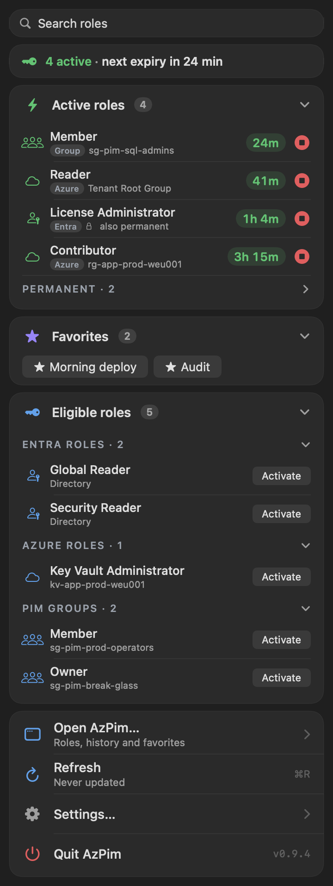
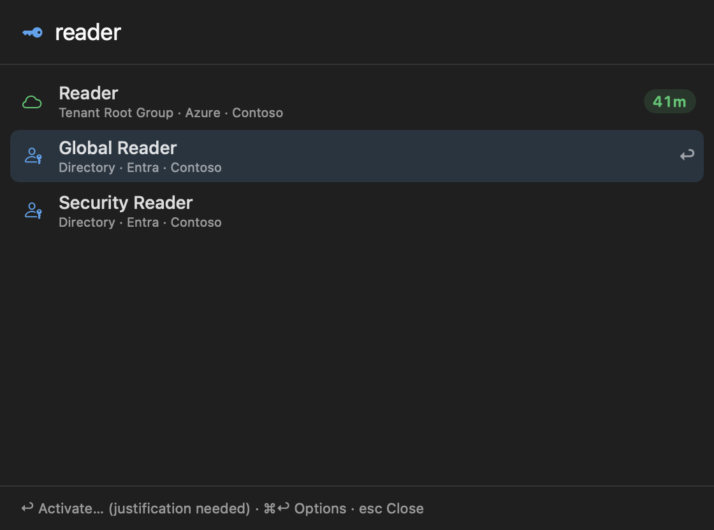
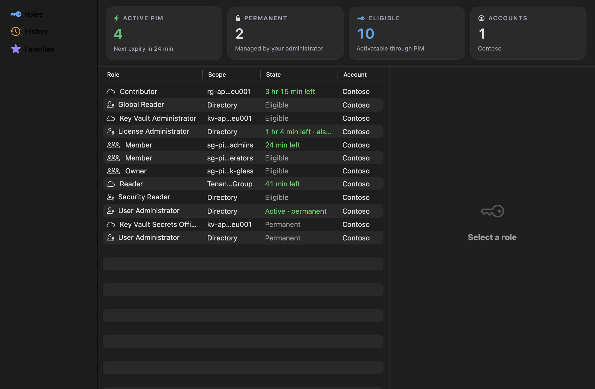

<p align="center">
  
</p>

<h1 align="center">AzPim</h1>

<p align="center">
  Your Microsoft PIM roles in the macOS menu bar: see what is active, activate, extend and end roles,
  without opening the Azure portal.
</p>

<p align="center">
  <a href="https://vincentlauriat.github.io/AzPim/">Website</a> ·
  <a href="#install">Install</a> ·
  <a href="#sign-in">Sign-in</a> ·
  <a href="#privacy-and-security">Privacy</a> ·
  <a href="LICENSE">MIT license</a>
</p>

<p align="center">
  
  
</p>

> **Status: 0.9, pre-1.0.** The signed DMG works with Azure CLI. It ships without a client ID, so Microsoft sign-in
> (Entra roles and PIM groups) needs your own app registration and has not been tested live yet; it comes with 1.0.

## Why

Privileged Identity Management (PIM) gives you roles *just in time*: you activate a role for a few hours, with a
justification, then it expires. In the portal that is 6 to 10 clicks per role, and nothing tells you that a role is
about to end in the middle of a deployment. AzPim keeps all of it one click away in the menu bar.

## Features

| | |
|---|---|
| **Active roles at a glance** | The panel opens on the number of active PIM roles, the next expiry and a progress bar; permanent roles are listed too. |
| **Menu bar countdown** | `2 · 0:41` next to the key icon, orange at 15 minutes, red at 5. |
| **One-click activation** | Duration capped by the role policy, last justification pre-filled. The result arrives as a notification (or inline when notifications are off), never a dialog. |
| **Least-privilege durations** | The sheet starts on the duration you last used for the role (1 h the first time), in 15-minute steps up to the policy maximum, with a **Max** button. |
| **Ticket fields** | Ticket system and number side by side when the policy asks for them, remembered per tenant; a favorite asks once per tenant. |
| **Quick-activate palette** | ⌃⌥P from any app: type a few letters, Return activates with the default duration, ⌘Return opens the sheet. |
| **Deactivate** | End a role as soon as you are done (Azure refuses it in the first 5 minutes; the button says so). |
| **Expiry notifications** | A reminder before the end, with an **Extend** button. |
| **Favorites** | Activate several roles in one click, from the panel or `azpim://activate?favorite=<name>` (always confirmed). |
| **Shortcuts** | *Activate Role*, *Run Favorite*, *List Active Roles* and *Deactivate All Roles* actions for Shortcuts, Siri and Spotlight (and Raycast or Alfred through `shortcuts run`). Every request is confirmed, missing justifications and tickets are asked, and the same setting as links turns activation off (*Deactivate All Roles* is not gated by it: it only removes access, after its own confirmation). A shortcut started by `shortcuts run` or Raycast still shows the confirmation; with no UI to show it, it fails without sending anything (to be verified live). |
| **History** | Every request, pending approvals (including ones sent from the portal) with **Cancel**, CSV export, median time to activate. |
| **Roles window** | Search and filter every role, see its policy: maximum duration, justification, ticket, MFA, approval. |
| **Several accounts and tenants** | One panel, filter per account; a favorite spanning tenants shows each role's tenant. |
| **Three PIM sources** | Azure resource roles, Entra roles and PIM for Groups. *Sign in with Microsoft* (recommended at onboarding) brings all three; the Azure CLI covers Azure roles only. |
| **French and English** | The app follows the macOS language. |

<p align="center">
  
</p>
<p align="center">
  
  
</p>
<p align="center">
  
</p>
<p align="center">
  
</p>

Screenshots use demo data (Contoso).

## Install

Requires macOS 14 or later. Download the signed and notarized DMG from
[GitHub Releases](https://github.com/vincentlauriat/AzPim/releases/latest) and drag AzPim to Applications.
Updates arrive automatically through Sparkle, or from Settings › About › Check for Updates.

> **Upgrading from 0.9.x (AzurePim).** Up to 0.9.3 the app was called AzurePim. AzPim has a new bundle id, so
> AzurePim does not update to it: its update check points to this page instead. Quit AzurePim, download AzPim once
> by hand and open it (it asks you to quit AzurePim if it is still running). On first launch it copies its local
> data (the account list, favorites and history) from `~/Library/Application Support/AzurePim/` and its panel and
> link preferences, leaving the originals in place, and registers itself at login if AzurePim was. Then remove
> AzurePim from Applications and its entry from System Settings › General › Login Items; AzPim reminds you once if
> AzurePim is still installed. Microsoft sign-in accounts may ask you to sign in again. Updates then arrive
> automatically again.

To build from source, you need Xcode (stable) and [XcodeGen](https://github.com/yonaskolb/XcodeGen):

```bash
git clone https://github.com/vincentlauriat/AzPim.git && cd AzPim
xcodegen generate
xcodebuild -project AzPim.xcodeproj -scheme AzPim -configuration Debug \
  -derivedDataPath build build
open build/Build/Products/Debug/AzPim.app
```

AzPim lives in the menu bar, with no Dock icon. On a notched MacBook with a full menu bar, the key icon may be
hidden: free some room or use a menu bar manager.

## Sign-in

| Mode | What you need | What you get |
|---|---|---|
| **Azure CLI** | `brew install azure-cli`, then `az login` | Azure resource roles. Nothing to register, no admin needed. |
| **Microsoft sign-in** | An app registration client ID (Settings › Accounts) and, in most tenants, a one-time admin consent | Azure resource roles, Entra roles and PIM groups. |

The Azure CLI token cannot request the Graph PIM permissions, which is why Entra roles and PIM groups need the
Microsoft sign-in. Delegated permissions, always on behalf of the signed-in user:

- `https://management.azure.com/user_impersonation`
- `User.Read`
- `RoleEligibilitySchedule.Read.Directory`, `RoleAssignmentSchedule.ReadWrite.Directory`, `RoleManagementPolicy.Read.Directory`
- `PrivilegedEligibilitySchedule.Read.AzureADGroup`, `PrivilegedAssignmentSchedule.ReadWrite.AzureADGroup`, `RoleManagementPolicy.Read.AzureADGroup`

A ready-to-send email for your tenant admin is in
[docs/admin-consent/email-template-tenant-admin.md](docs/admin-consent/email-template-tenant-admin.md).

AzPim never grants anything by itself: every activation goes through PIM, which still enforces approval, MFA,
ticket and maximum duration.

## Privacy and security

- **No server, no telemetry, no account.** AzPim talks only to `management.azure.com`, `graph.microsoft.com`
  and `login.microsoftonline.com`.
- **AzPim stores no token.** The Azure CLI keeps its own; the Microsoft sign-in uses the Keychain cache of
  Microsoft's MSAL library.
- **Local data** (roles, policies, history, favorites) sits in `~/Library/Application Support/AzPim/`, a folder
  only your user can read. *Settings › Accounts › Privacy › Delete All Local Data* signs out and wipes it.
- **`az` is run safely:** explicit arguments, no shell, a minimal environment; a custom path must be owned by you or
  root and not writable by others.
- Two independent security reviews ran during development; findings and accepted risks are in the
  [TRD](TRD.md#security-and-privacy).

## Build and test

```bash
swift test --package-path Packages/AzPimCore                  # logic tests
swiftlint lint                                                    # style
AZPIM_LIVE=1 swift test --package-path Packages/AzPimCore   # read-only live tests, needs `az login`
```

Debug builds can render the panel and windows to PNG files, with demo data, without clicking the menu bar:

```bash
AZPIM_SNAPSHOT=/tmp/shots build/Build/Products/Debug/AzPim.app/Contents/MacOS/AzPim
```

## Releasing

```bash
./Scripts/release.sh 0.9.3                    # from a clean main, with release/release-notes-0.9.3.md
gh release create v0.9.3 ./release/AzPim-0.9.3.dmg --title "v0.9.3" --notes-file release/release-notes-0.9.3.md
./Scripts/release.sh --publish-appcast 0.9.3  # checks the DMG URL answers, prepends the item to appcast.xml
```

The build run refuses to start without release notes, off `main`, with a dirty tree, when HEAD is not `origin/main`
or when tag `vX.Y.Z` already exists. It refuses a build number that is not strictly greater than every build in
`appcast.xml` and in the `project.yml` of every `v*` tag. It checks the Developer ID signature and Hardened Runtime
before notarizing, and Gatekeeper on the app inside the stapled DMG. `--publish-appcast` downloads the uploaded
asset and refuses it unless its SHA-256 matches the signed DMG. `appcast.xml` then goes to `main` through a PR.

CI checks on every PR that `appcast.xml` is well-formed, is not ahead of `project.yml` (build and marketing
version) and has no duplicate build numbers.

## Rollback and withdrawal

Sparkle has no downgrade: an installed app only moves to a higher build number. A bad release is withdrawn, and
fixed by the next build.

1. **Stop the offer.** Remove the bad `<item>` from `appcast.xml` and merge that through a PR. Apps still on the
   previous version stop being offered the bad one once raw.githubusercontent.com refreshes (about 5 minutes).
   Leave the other items alone.
2. **Mark the GitHub release.** Edit it: add "Withdrawn: do not install, see vX.Y.Z" at the top of the notes and
   mark it as a pre-release (`gh release edit vX.Y.Z --prerelease`), so it is not "Latest" on the releases page and
   the landing page. Keep the DMG attached unless it is harmful: deleting it breaks links for people who already
   installed it. Delete the asset only for a security issue.
3. **Never reuse a build number.** The withdrawn `CURRENT_PROJECT_VERSION` is burnt: the fix gets a higher build
   number (and a new marketing version), or Sparkle would not offer it to anyone who installed the bad build.
   Removing the item lowers the highest build in `appcast.xml`, so keep the `vX.Y.Z` tag: `Scripts/release.sh`
   refuses a build number that is not above every one in `appcast.xml` and in the `project.yml` of every `v*` tag.
4. **Ship the fix.** Users on the bad version get the next fixed build through the normal update check. If the bad
   build cannot update itself (broken updater or crash on launch), say so in the GitHub release and the issue, and
   point to the DMG of the fixed version for a manual reinstall.

**Monitoring after a release:**

- Download counts per asset: `gh release view vX.Y.Z --json assets --jq '.assets[] | "\(.name) \(.downloadCount)"'`.
- New [issues](https://github.com/vincentlauriat/AzPim/issues) in the first days, and the Sparkle feed itself:
  `curl -fsS https://raw.githubusercontent.com/vincentlauriat/AzPim/main/appcast.xml` shows what clients see.

## Project layout

| Path | Content |
|---|---|
| `AzPim/` | SwiftUI app: menu bar panel, Roles / History / Favorites windows, settings, services |
| `Packages/AzPimCore/` | UI-free logic: token providers, ARM and Graph PIM clients, models, validation, tests |
| `docs/` | Website (GitHub Pages), screenshots (`docs/images/`), admin consent email template |
| `project.yml` | XcodeGen spec (MSAL and Sparkle pinned to exact versions) |
| `Scripts/release.sh` | Builds, signs, notarizes (App Store Connect API key, or keychain profile) and packages the DMG, and writes `appcast.xml` |
| `appcast.xml` | Sparkle update feed |

| Document | Content |
|---|---|
| [PRD.md](PRD.md) | Product, features, acceptance criteria, open questions |
| [TRD.md](TRD.md) | Technical choices, APIs, permissions, security |
| [AppFlow.md](AppFlow.md) | Screens, paths, states |
| [DesignBrief.md](DesignBrief.md) | Visual direction and UX rules |
| [BackendSchema.md](BackendSchema.md) | Local data model |
| [ImplementationPlan.md](ImplementationPlan.md) | Build order and traceability |

## Roadmap

- [x] Step 1 — project setup
- [x] Step 2 — data and sign-in (Azure CLI, Microsoft sign-in)
- [x] Step 3 — activate, deactivate and track from the menu bar
- [x] Step 4 — extend, favorites, history, several accounts, Roles window
- [ ] Step 5 — quality: error states, accessibility, performance, security reviews (in progress)
- [x] Step 6 — signed and notarized DMG, automatic updates (Sparkle): 0.9.4 shipped (first AzPim build), updates verified from 0.9.1
- [ ] Later — Mac App Store version

## License

[MIT](LICENSE). AzPim is not affiliated with Microsoft. Azure, Entra and Microsoft are trademarks of Microsoft.
